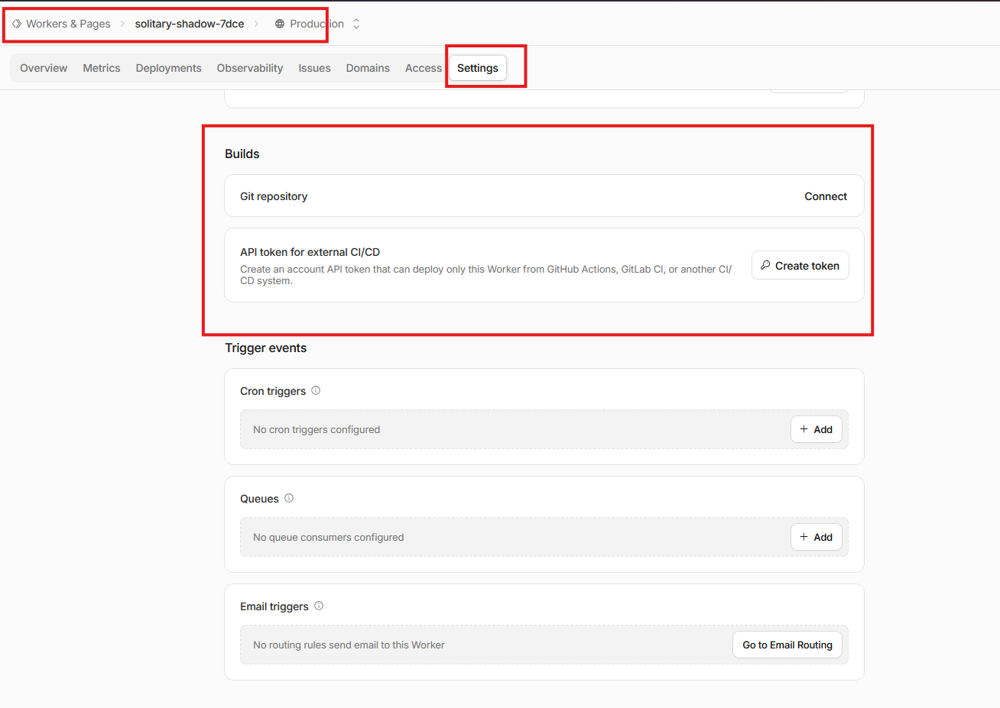
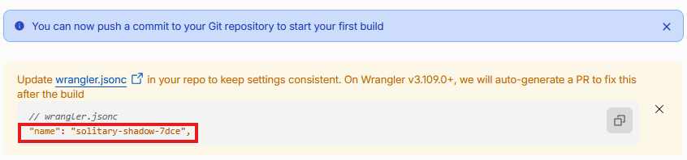
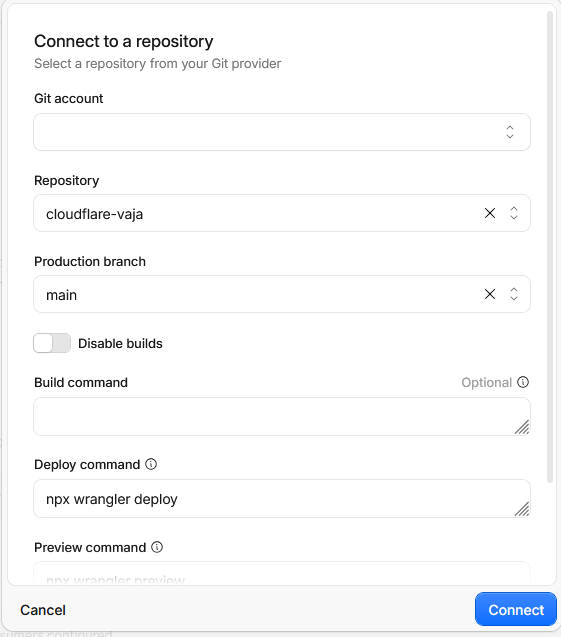
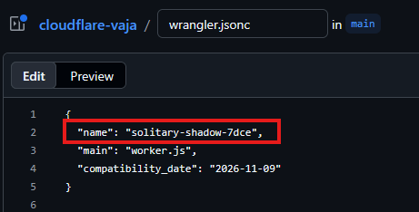
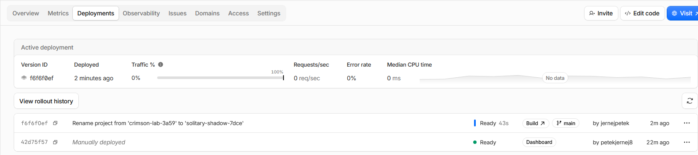
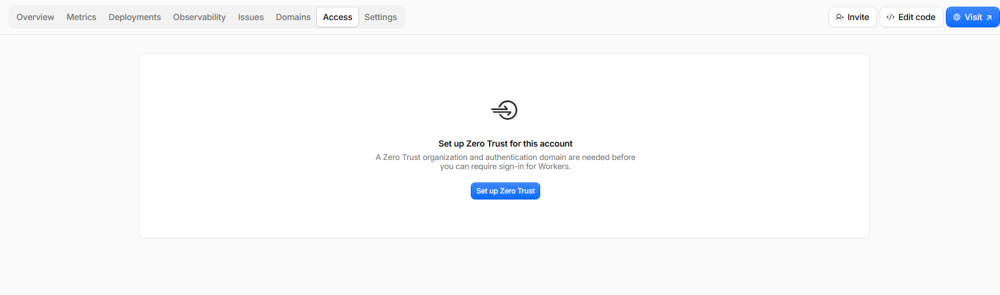
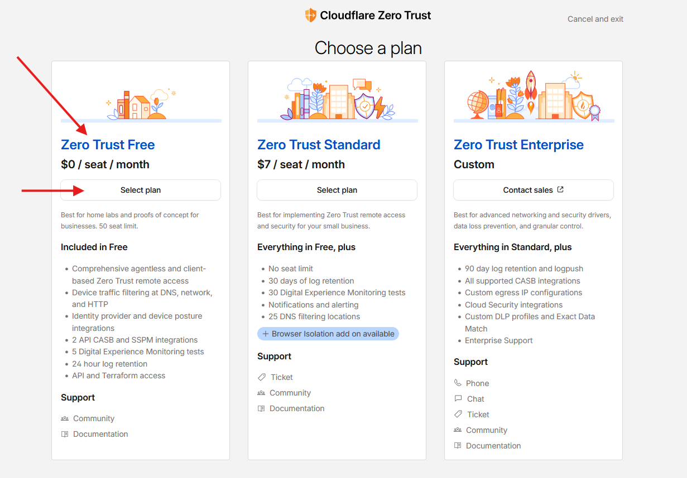

# Cloudflare Workers in Cloudflare Access

## Namen vaje

- Spoznati brezstrežniško izvajanje kode v oblaku na primeru Cloudflare Workers.
- Razumeti povezavo med repozitorijem GitHub in samodejno objavo Workerja.
- Preizkusiti omejevanje dostopa do spletne storitve s Cloudflare Access.

## 1. Ustvarjanje računa Cloudflare

Na [spletnem mestu Cloudflare](https://www.cloudflare.com/) ustvarite račun oziroma se prijavite. Če je mogoče, uporabite prijavo z računom GitHub.

## 2. Ustvarjanje Workerja

Pri brezstrežniškem (serverless) modelu ponudnik upravlja infrastrukturo, na kateri se izvaja koda. Razvijalec se zato lahko osredotoči na kodo in njeno objavo, ne pa na vzdrževanje strežnikov.

Cloudflare Workers omogoča izvajanje kode na Cloudflarovem omrežju. Ustvarite preprost Worker:

1. Odprite **Compute > Workers & Pages > Create application** in izberite **Hello World**.
2. Možnost **Protect with Cloudflare Access** za zdaj pustite izklopljeno.
3. Če želite, določite krajše ime Workerja, nato ga objavite (**Deploy**) in odprite njegov URL.

Zapišite URL Workerja. 

    Odgovor: icy-dust-67b9.gm08380.workers.dev

Obiščite naslov (gumb **Visit** zgoraj desno) ali z vnosom URL v naslovno vrstico brskalnika. Kje se izvaja koda, ki vrne rezultat?

    Odgovor: Koda se izvaja na Cloudflarovih strežnikih v oblaku, v njihovem globalnem omrežju, in ne na našem lokalnem računalniku.

Katere komponente strežniškega sistema v tem brezstrežniškem modelu upravlja Cloudflare namesto razvijalca?

    Odgovor: Cloudflare upravlja fizične strežnike, procesorje, pomnilnik, omrežno infrastrukturo, operacijski sistem, varnost in skaliranje strežniških virov. Razvijalcu se zato ni treba ukvarjati z vzdrževanjem strežniške infrastrukture.


> **Zanimivost**: zelo podobno kot ustvarjanje in gostovanje aktivnih Workerjev, Cloudflare omogoča tudi postavitev statičnih spletnih strani/vsebin, npr. HTML, CSS, (klientski) JS, slike itd. Ta možnost se v Cloudflare imenuje *Pages*.

## 3. Spreminjanje kode v nadzorni plošči Cloudflare

V nadzorni plošči odprite urejanje Workerja in spremenite odgovor tako, da izpiše:

> Pozdravljen svet!

Spremembo objavite in preverite rezultat. 
Kaj v razvoju spletnih aplikacij pomenita koraka Build in Deploy ter zakaj v našem primeru v vmesniku vidimo le gumb Deploy (brez ločenega koraka Build)?

Kaj v razvoju aplikacij pomenita koraka **Build** in **Deploy**? 

    Odgovor: Build pomeni pripravo aplikacije za objavo, pri kateri se koda po potrebi prevede, združi in pripravi za izvajanje. Deploy pa pomeni objavo aplikacije na strežnik, da postane dostopna uporabnikom.


Zakaj v našem enostavnem primeru v vmesniku vidimo ne vidimo gumba **Build**?

    Odgovor: Ker je naš Worker zelo preprost in ne potrebuje posebnega postopka gradnje. Koda je že pripravljena za izvajanje, zato jo lahko neposredno objavimo z gumbom Deploy.


## 4. Povezava z GitHubom

1. Odprite **Cloudflare Dashboard**.
2. Pojdite na **Workers & Pages**.



3. Izberite svojega Workerja.
4. Odprite **Settings → Builds**.
5. Poiščite možnost **Connect** oziroma **Connect to GitHub**.
6. Izberite svoj repozitorij te laboratorijske vaje.



7. Kot produkcijsko vejo izberite `main`.

> **POZOR:**
> Ime Workerja v Cloudflare se mora ujemati z imenom, določenim v datoteki `wrangler.jsonc` v vašem GitHub repozitoriju.



```jsonc
// wrangler.jsonc
{
  "name": "solitary-shadow-7dce",
  "main": "worker.js",
  "compatibility_date": "2026-11-09"
}
```



V zavihku **Deployments** lahko sedaj spremljate spremembe, ki jih preko GitHub-a delate na svojem workerju:



V datoteki `wrangler.jsonc` poiščite nastavitve za ime Workerja, glavno datoteko in datum združljivosti. Čemu služijo?

    Odgovor: Name določa ime Workerja v Cloudflare. Main določa glavno datoteko, v kateri se nahaja koda Workerja. Compatibility_date določa datum.združljivosti, ki določa, katere različice funkcionalnosti in API-jev Cloudflare Workers se uporabljajo pri izvajanju kode.

V Cloudflare ustvarite Worker, povezan s svojim repozitorijem GitHub. Preverite, da je bil Worker uspešno objavljen, in zapišite njegov URL.

    Odgovor: vaja-6-dsa-cloudflare.gm08380.workers.dev

V urejevalniku VS Code spremenite `worker.js`, da Worker izpiše:

> Pozdravljen GitHub!

Spremembo shranite, potrdite (commit) in pošljite (push) v GitHub. Preverite, ali Cloudflare samodejno izvede gradnjo in objavo. 

    Odgovor: Da. Po shranjevanju sprememb, izvedbi commita in pošiljanju (push) v GitHub Cloudflare samodejno zazna spremembe v repozitoriju, izvede potrebno gradnjo in objavi novo različico Workerja.

## 5. Zaščita s Cloudflare Access

## Pomembno opozorilo pred začetkom

Za izvedbo 5. naloge je treba ob prvi uporabi storitve **Cloudflare Access** opraviti začetno nastavitev **Cloudflare Zero Trust**.

Med postopkom je treba izbrati naročniški paket in lahko tudi pri brezplačnem paketu vnesti osebne ter plačilne podatke (npr. ime, naslov, telefonsko številko in podatke o bančni kartici).

Priporočamo, da pred nadaljevanjem preverite, katere podatke storitev zahteva, in se sami odločite, ali jih želite posredovati. Posebna previdnost je priporočljiva pri uporabi šolskih ali skupnih računalnikov. Po potrebi se glede alternativne izvedbe naloge posvetujte z izvajalcem vaj.

## Začetna nastavitev Cloudflare Zero Trust

1. V nadzorni plošči Cloudflare odprite **Workers & Pages** in izberite svojega Workerja.
2. Odprite zavihek **Access**.
3. Kliknite **Setup Zero Trust**.



4. Če storitev zahteva ime ekipe (*Team name*), izberite poljubno ime.
5. Med ponujenimi naročniškimi paketi izberite **Free plan ($0)**.



6. Če storitev zahteva podatke za obračunavanje, jih vnesite le, če se s tem strinjate. Pred potrditvijo preverite, da je izbran brezplačni paket in da niso vključene plačljive storitve.
7. Dokončajte začetno nastavitev in se vrnite na zavihek **Access** svojega Workerja.

## Nastavitev zaščite Workerja

1. Izberite **Protect with Cloudflare Access**.
2. Pri nastavitvi **Scope** izberite **All traffic**.
3. Pri **Authentication policy** izberite **Cloudflare account**.
4. Shranite nastavitve.

Če ste prejšnje korake uspešno izvedli, nadaljujte z zadnjim dvema korakoma.

Ustvarite še en Worker oziroma ustrezno spremenite obstoječega ter vklopite možnost **Protect with Cloudflare Access**. Nastavite pravilo dostopa, ki dovoli dostop vašemu računu. Preizkusite URL v zasebnem oknu brskalnika in po prijavi.

Kaj vidi neprijavljeni obiskovalec, kaj se zgodi po prijavi in kdaj Worker obdela zahtevo? Pojasnite tudi razliko med prijavo v nadzorno ploščo Cloudflare z računom GitHub in uporabo Cloudflare Access za zaščito Workerja.

    Odgovor: Neprijavljeni obiskovalec vidi prijavno stran Cloudflare Access, po uspešni prijavi pa lahko dostopa do Workerja, ki šele takrat obdela njegovo zahtevo. Prijava z GitHub računom omogoča dostop do nadzorne plošče Cloudflare, Cloudflare Access pa omejuje dostop do same spletne aplikacije.
